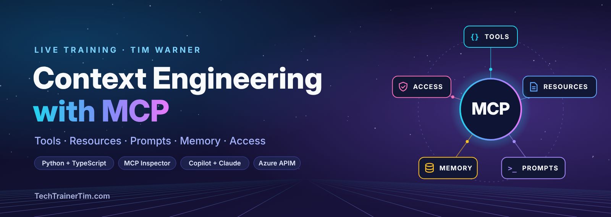
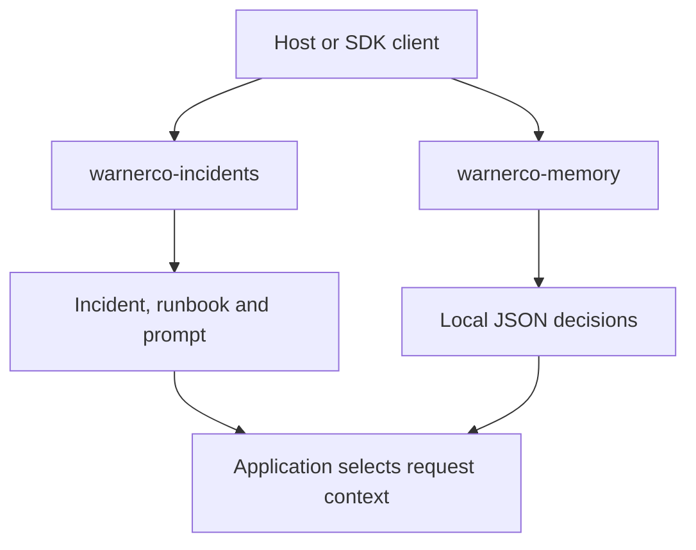

<div align="center">
  
</div>

# Context Engineering with MCP

[](https://github.com/timothywarner-org/context-engineering-with-mcp/actions/workflows/verify.yml)
[](https://modelcontextprotocol.io/specification/2026-07-28)
[](https://github.com/modelcontextprotocol/python-sdk)
[](https://github.com/modelcontextprotocol/typescript-sdk)
[](LICENSE)
[](https://techtrainertim.com)
[](https://github.com/timothywarner-org)

Tim Warner | Pearson Enterprise Live Training | October 22, 2026

**Learn how MCP connects an AI application to useful context.** Follow one
incident from a tool call to a retrieved runbook, persistent memory, and an access
decision. Each example helps you answer three questions: **What information does
the assistant need? Where does it come from? What is the assistant allowed to do?**

MCP provides a common interface for discovering and using capabilities. Your
application still decides what enters the model's context, what persists between
requests, and which actions are authorized. Connecting a server doesn't make those
decisions for you.

**Attending live?** Tim runs every demo on screen. Participate through predictions,
polls, chat, and the worksheet; installing tools is optional. Get the slide PDF,
participant worksheet, and links PDF from your Pearson session's **Resources** widget.

**Practicing afterward?** Start with [your first successful tool call](#your-first-successful-tool-call),
then follow the learning route below. The first example needs no model account,
API key, Node.js installation, or Azure subscription.

**Want every click and command?** Use the [step-by-step demo tutorials](TUTORIALS.md).
Each tutorial includes numbered actions, expected results, and explanations.
For a slower walkthrough of persistence and retrieval, jump directly to the
[memory tutorial](TUTORIALS.md#4-carry-memory-across-processes).

## Learning route

Follow one fictional incident, **INC-1042**, from a context problem through tool use,
durable memory, and access decisions. All business data is fictional.

| Step | Open or run | What you should be able to explain |
|---|---|---|
| 1. Choose useful context | [Context audit](#context-audit-and-governance-practice) | What the assistant needs, what adds noise, and which measurements are real. |
| 2. Call a tool and read a resource | [Python client](#call-the-server-from-python) | How a client gets incident data and a runbook, including a deliberate failure. |
| 3. Inspect the exchange | [MCP Inspector](#inspect-the-server) | The difference between discovering a capability and successfully using it. |
| 4. Connect your preferred host | [Host configuration](#connect-a-host) | How a host launches the same server and lets you review access. One host is enough for practice. |
| 5. Carry context across processes | [Memory demonstration](#understand-the-memory-demonstration) | What survives a process exit and why storage alone doesn't supply model context. |
| 6. Decide who may do what | [Governance exercise](#context-audit-and-governance-practice) | Where token, scope, and data-access decisions belong. |
| Optional extension | [Azure gateway demonstration](#explore-the-azure-gateway-demonstration) | How routing, denial, and throttling affect real requests. |

### Two ways to practice the same workflow

The first segment is developer-focused: inspect the server contract, run the
model-free client, and prove persistence and selection with two MCP servers.
The second is maker/author-focused: use a host to inspect its context, select
tools and evidence, compare workflow guidance, and reuse a saved decision in a
fresh conversation. Both use the same fictional incident.

Continue with [context, instructions and memory](docs/context-engineering.md)
to distinguish skills, subagents, conversation branches and durable records.

## What is in this repository

- `python/`: official MCP Python SDK 2.3.0 starter, pinned with `uv.lock`.
- `python/client.py`: small SDK client that calls the existing server without a model or API key.
- `typescript/`: official TypeScript SDK server 2.3.1 starter, pinned with `package-lock.json`.
- [`memory-mcp/`](memory-mcp/README.md): three MCP tools for durable local JSON memory.
- [`memory/`](memory/README.md): optional Python-only SQLite comparison.
- `clients/New-ClientConfigs.ps1`: portable configuration generator for three hosts and Inspector.
- `context/`: small and large fictional incident files for the context audit.
- `governance/request-review.json`: remote authorization and gateway decision exercise.
- [`azure-demo/`](azure-demo/README.md): the optional Azure Container Apps and API Management supplement, with tool-specific routes, denial, and throttling.
- Slides, participant worksheet, and links PDF: in the Resources widget for your Pearson session.
- `evidence/`: dated reference results; [GitHub Actions](https://github.com/timothywarner-org/context-engineering-with-mcp/actions/workflows/verify.yml) checks the current code on Windows and Linux.

### How the pieces connect

A host or SDK client can connect to two independent stdio servers. The incident
server supplies facts, a runbook resource and an investigation prompt. The memory
server stores selected decisions and retrieves them for later requests.
The application decides what evidence enters the model's context.



MCP carries requests and results. Durable storage, compression policy and
authorization remain application responsibilities. The optional Azure supplement
adds a separate HTTP gateway example.

## Optional preparation

### Your first successful tool call

Use **PowerShell 7**, **Git**, and **uv**. The locked project supports Python 3.11 or
later; the commands below select Python 3.12, matching the verification workflow.
uv can obtain that interpreter if it isn't installed.

If you already have this repository, open a terminal in that checkout and skip the
clone. Otherwise, run:

```powershell
# Clone once so every exercise uses the same working copy.
git clone https://github.com/timothywarner-org/context-engineering-with-mcp.git
if ($LASTEXITCODE) { throw 'Clone failed; resolve the error before continuing.' }
Set-Location -LiteralPath .\context-engineering-with-mcp
```

From the repository root:

```powershell
# Use the lock file and the same Python version as the course verification workflow.
uv sync --project .\python --locked --python 3.12
if ($LASTEXITCODE) { throw 'Python setup failed; resolve the error before continuing.' }

# This client starts and stops its own server; no separate terminal or model is needed.
uv run --locked --project .\python python .\python\client.py
if ($LASTEXITCODE) { throw 'Client demo failed; see Troubleshooting below.' }
```

**Look for:** tool `get_incident`, owner **Priya Patel**, a timeout after deployment,
the runbook's instruction to request approval before rollback, and a final
`is_error=True` for the deliberately missing incident. That last result is expected.
[The client explanation](#call-the-server-from-python) separates this expected tool
error from a failed demo.

### Add tools only for the next exercise

| Exercise | Additional preparation |
|---|---|
| SQLite memory or local HTTP checks | None beyond the locked Python setup above. |
| MCP memory lifecycle | Node.js 22.19 or later with npm; build memory-mcp below. |
| Inspector | Node.js 22.19 or later with npm; generate the client snippets below. |
| TypeScript implementation and full regression checks | Node.js 22.19 or later with npm; install and build below. |
| Host integration | A supported host and its required account/access; generate snippets and review consent. |
| Azure deployment | Optional. Read the supplement's prerequisites and cost boundaries first. |

For Inspector or a host, generate configuration for **your** checkout path:

```powershell
# Generated absolute paths prevent the host from launching a different checkout.
.\clients\New-ClientConfigs.ps1
if (-not $?) { throw 'Configuration generation failed.' }
```

For the TypeScript example and the full Python/TypeScript regression checks:

```powershell
# Keep the TypeScript installation local and reproducible.
Push-Location .\typescript
try {
    npm ci
    if ($LASTEXITCODE) { throw 'TypeScript dependency installation failed.' }
    npm run build
    if ($LASTEXITCODE) { throw 'TypeScript build failed.' }
} finally { Pop-Location }

# Both implementations must return meaningful success and failure results.
uv run --locked --project .\python python .\verify_protocol.py
if ($LASTEXITCODE) { throw 'Protocol verification failed.' }
```

Expect six protocol checks per language: discovery, tool listing, normalized incident lookup, resource read, prompt retrieval, and an unknown-ID tool error. The known incident is `INC-1042`; its owner is `Priya Patel`. All business data is fictional.

## Call the server from Python

After installing the locked Python dependencies, run this from the repository root:

```powershell
# The SDK manages the stdio subprocess, including discovery and cleanup.
uv run --locked --project .\python python .\python\client.py
```

The client lists `get_incident`, calls it with `INC-1042`, reads the approved runbook,
and requests `MISSING` to show an explicit tool error. Expect Priya Patel, the timeout
symptom, the instruction to request approval before rollback, and `is_error=True`
for the missing incident. All business data is fictional.

The existing server raises `ValueError` for a missing incident. The SDK logs that
exception to stderr and returns `Error executing tool get_incident` to the client.
The traceback is server diagnostics; `is_error=True` is the returned tool result.

An MCP client can make these requests without a language model. The script uses
`Client` and `StdioServerParameters` from the same pinned official `mcp` package as
the server. It starts `python/server.py` with its own Python interpreter and an
absolute path, then closes the connection and server on exit. No separate server
terminal, new package, or credential is required. Requests have a ten-second timeout,
and the complete demonstration has a thirty-second timeout. Unexpected failures
exit with a nonzero status; the deliberate missing-incident result is part of a
successful demonstration.

Use this small client to learn the SDK calls. When you change a server, use
`verify_protocol.py` to check both implementations, including normalization and
prompt retrieval.
See the [official SDK client guide](https://py.sdk.modelcontextprotocol.io/client/).

## Inspect the server

```powershell
# Pin Inspector to the version verified with this release.
npx --yes @modelcontextprotocol/inspector@2.9.0 --cli --config clients/generated/inspector.json --server warnerco-incidents --method tools/call --tool-name get_incident --tool-arg incident_id=INC-1042 --format json

# Read the resource separately: discovery alone isn't functional verification.
npx --yes @modelcontextprotocol/inspector@2.9.0 --cli --config clients/generated/inspector.json --server warnerco-incidents --method resources/read --uri warnerco://runbooks/order-api --format json

# Start the graphical Inspector when you want to explore the same exchange.
npx --yes @modelcontextprotocol/inspector@2.9.0 --config clients/generated/inspector.json --server warnerco-incidents
```

Keep the server's stdout reserved for protocol messages. Diagnostics go to stderr. If a server appears idle when launched directly, it's waiting for protocol input.

The generator selects `protocolEra: "modern"` inside the Inspector server entry.
Both the graphical and command-line Inspector use that saved selection.
This setting is specific to Inspector and isn't added to the other host snippets.

## Connect a host

Generate snippets first. The default contains only `warnerco-incidents`. After building memory-mcp, regenerate with `-IncludeMemory` and merge both named WARNERCO entries. Preserve unrelated settings.

| Host | Supplied snippet | Placement |
|---|---|---|
| GitHub Copilot in VS Code | `clients/generated/vscode-mcp.json` | Workspace `.vscode/mcp.json`, using `servers` |
| Portable Copilot | `clients/generated/copilot-mcp.json` | Supported Copilot destination, using `mcpServers`; follow your selected harness guide |
| Claude Code | `clients/generated/claude-code.mcp.json` | Project `.mcp.json`, using `mcpServers` |
| Claude Desktop | `clients/generated/claude-desktop.json` | Desktop configuration described in the official local-server guide, using `mcpServers` |

Restart or reload the connection as required by your host. Review its access or
consent request. Confirm `get_incident` is available, then request the owner and
symptom for `INC-1042`. Compare the response with the source data: a model's
assurance that it connected isn't evidence of a successful tool call. Host
interfaces and account permissions differ; use your host's documentation for its
configuration location and access controls.

### Use resources and prompts in VS Code Copilot

Use Copilot Chat as the model-driven client, with the course server connected.
Exercise all three capabilities, not only the incident tool:

1. Request `get_incident` for `INC-1042`. Expand the tool call and inspect its actual
   input and returned owner, status, and symptom.
2. Run **MCP: Browse Resources** from the Command Palette. Select the course server's
   `warnerco://runbooks/order-api` resource and inspect the procedure.
3. In Chat, use **Add Context > MCP Resources** to attach that resource. Confirm it
   appears as attached context, then ask: "Using the attached runbook and the incident
   tool result, separate observed facts from hypotheses and recommend the next check.
   What requires approval? Do not change files or perform a rollback."
4. Type `/` in Chat and select the server's `investigate_incident` prompt from the
   available completions. Use `INC-1042` for its incident argument and inspect the
   prepared request. A prompt supplies instructions; it is not a stored result.

**Context connection:** the tool returns incident facts; the resource contributes
selected reference material; the prompt frames the task. Attaching a resource does
not create durable memory or authorize an action. If a capability is missing from
your session, inspect it in Inspector while resolving the host configuration.

VS Code configuration depends on the selected agent harness. The supplied `servers`
snippet is the VS Code format; portable Copilot configuration uses `mcpServers`.
Keep an existing working connection. For a new setup, follow the current
[configuration destinations and resource controls](https://code.visualstudio.com/docs/agent-customization/mcp-servers)
and [resource and prompt behavior](https://code.visualstudio.com/api/extension-guides/ai/mcp).
Picker labels and prompt prefixes can vary by version; select the discovered entry.

## Understand the memory demonstration

Build the second server once. This exercise adds Node.js 22.19 or later with npm
to the locked Python setup; the first incident call still needs Python only.

```powershell
npm --prefix memory-mcp ci
if ($LASTEXITCODE) { throw 'Memory dependency installation failed.' }
npm --prefix memory-mcp run build
if ($LASTEXITCODE) { throw 'Memory build failed.' }
npm --prefix memory-mcp test
if ($LASTEXITCODE) { throw 'Memory tests failed.' }
.\clients\New-ClientConfigs.ps1 -IncludeMemory
if (-not $?) { throw 'Two-server configuration generation failed.' }
uv run --locked --project .\python python .\memory-mcp\demo.py
if ($LASTEXITCODE) { throw 'MCP memory demonstration failed.' }
```

Follow the output: retrieve INC-1042 and its runbook, write a decision, close that
session, retrieve it in an independent process, select and compress it, then
assemble an explicit request file. The tools are **memory_write**, **memory_search**
and **memory_compress**. Hosts use local JSON at `.local/memory/warnerco.json`.
The full scripted demo uses a temporary store, then removes it after proving
persistence across its two child processes. It leaves the request file and does
not pre-seed the host store. Split phases require an explicit absolute memory path.

The demo writes `.local/memory/host-context.txt`. Open a fresh host chat and
attach or paste that file to complete the model-facing reuse step. Inspect the
answer and actual tool activity. The script invokes no model; a saved file alone
is not evidence that a host used it.

Search uses exact English word matches, tags and keywords, with no recency bonus
for unrelated notes. Compression selects and truncates; it does not summarize
with an LLM. The budget bounds UTF-16 units in the returned `context` field, not
model tokens or the complete JSON response. A small budget may cut a caveat, so
inspect the result before use.

Use the [numbered tutorial](TUTORIALS.md#4-carry-memory-across-processes) for the
session boundary, missing-memory case, budget comparison and explicit host reuse.
See the [memory server reference](memory-mcp/README.md) for schema and limits.

The original [SQLite memory exercise](memory/README.md) remains an optional
Python-only comparison of working, episodic, semantic and procedural memory.
It is a separate application and does not share the new JSON store.

## Context audit and governance practice

Compare [`context/incident-brief.txt`](context/incident-brief.txt) with
[`context/large-context.txt`](context/large-context.txt). Identify the facts needed
to investigate the incident, the material that adds noise, and the information you
would retrieve only when needed. If your host exposes context or token counters,
record those measurements. File bytes and word counts aren't model token counts;
the session worksheet's sample budget is illustrative.

Read [`governance/request-review.json`](governance/request-review.json) and locate
the token, scope, and data-access decisions. Explain which component should enforce
each decision and what evidence would show that a request was denied. This is a
design exercise: the local stdio starters don't implement remote OAuth or
production identity enforcement.

## Explore the Azure gateway demonstration

The [ACA/APIM supplement](azure-demo/README.md) runs the same fictional incident
behind a real gateway. It routes incident and runbook tools to separate endpoints
in one container, denies the rollback fixture, and limits runbook calls while
incident lookup remains available.

Run the HTTP server checks locally with the course's locked dependencies:

```powershell
# Verify endpoint behavior without Azure credentials or a model account.
uv run --locked --project .\python python .\azure-demo\verify_demo.py --local
```

The supplement includes deployment and live verification scripts for an existing
Azure environment, plus a [dated, sanitized live report](azure-demo/evidence/live-verification-2026-10-20.json).
Its authentication uses separate gateway and backend keys. OAuth consent,
per-user authorization, and private networking remain design extensions.
Attendees can watch the hosted demonstration without creating Azure resources.

## Understand the example's boundaries

The starters target the July 28, 2026 specification. They use pinned SDK versions
so you can reproduce the examples. The TypeScript starter uses the official
`serveStdio` entry point so the SDK chooses the protocol era.

The local examples demonstrate protocol behavior with fictional data. They don't
provide production authentication or authorization. The optional Azure example
adds gateway and backend keys, with the limits described above. Re-run the checks
after changing dependencies or host configuration, and keep credentials and real
incident data out of your commits and screenshots.

## Further reading

[WARNERCO Schematica](https://github.com/timothywarner-org/context-engineering/tree/main/src/warnerco/backend)
is the larger architectural reference behind the memory exercise. It has different
dependencies and a vector-backed knowledge store. **It is optional reading, not a
second setup route for this session.** Keep this repository as your working copy.

## Troubleshooting

- **Wrong folder:** run `Get-Location`. The repository root contains `python`, `typescript`, `memory`, and `clients`. All commands on this page start there.
- **Need installation instructions:** use the official [PowerShell](https://learn.microsoft.com/powershell/scripting/install/installing-powershell-on-windows), [Git](https://git-scm.com/downloads), [uv](https://docs.astral.sh/uv/getting-started/installation/), and [Node.js](https://nodejs.org/en/download) guides. Install only what your chosen exercise needs.
- Command not found: install the optional prerequisite, reopen your terminal, and regenerate configuration snippets.
- TypeScript module not found: run `npm ci` and `npm run build` inside `typescript`.
- Discovery returns Method not found: inspect SDK version, protocol era, and the server entry point. Compare with the supplied files.
- Tool is listed but fails: inspect arguments and the returned error; use `INC-1042` for the known success case.
- No JSON memory returned: verify the absolute path and meaningful search terms. Empty hits are a successful search with no matching evidence.
- Memory file error or busy lock: preserve the file; inspect the error and active writers. Never delete data or a lock while a writer may be using it.
- SQLite notes missing: verify that exercise's separate database path and scope.

## Instructor

[Instructor entry point](instructor/README.md).

## About the author

**Tim Warner** is a Microsoft MVP, a Microsoft Certified Trainer since 1997, and a
Principal Staff Author at Pluralsight with more than 200 courses and over a million
learners. He teaches live courses for Pearson and O'Reilly, and he builds and ships
MCP servers. His teaching model comes from Richard Feynman: start from first
principles, prove the idea with a working demo, and keep the examples close to real
enterprise work.

You'll find his video courses on [Pluralsight](https://www.pluralsight.com/authors/tim-warner),
short tutorials on [YouTube](https://www.youtube.com/@TechTrainerTim), more course
repositories on [GitHub](https://github.com/timothywarner-org), and everything else
at [TechTrainerTim.com](https://techtrainertim.com). Connect with him on
[LinkedIn](https://www.linkedin.com/in/timothywarner).

## License

The code is released under the [MIT License](LICENSE). See [NOTICE.md](NOTICE.md)
for source attribution.
