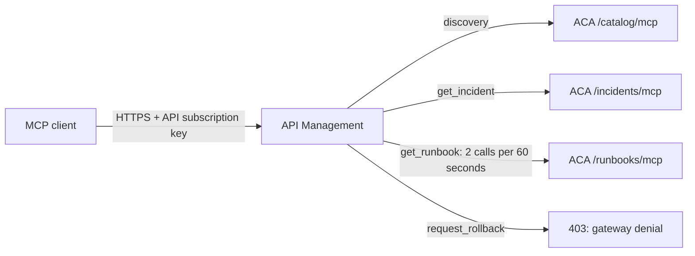

# MCP tool routing through API Management to Container Apps

**One real MCP server container, three SDK endpoint paths, one gateway URL.**
The example keeps the course's fictional WARNERCO incident, INC-1042, and Priya Patel.
It reuses existing Azure infrastructure and doesn't modify the Schematica application.

## Request path



The three paths run inside one container. They are distinct MCP endpoint instances,
not three separately deployed microservices. `servedBy` in each successful tool
result identifies the endpoint that actually executed it. An outbound gateway header
independently records the policy's route selection.

| Request | Gateway decision | Backend evidence |
| --- | --- | --- |
| `tools/list` | Default discovery route | Three tools in the catalog |
| `get_incident(INC-1042)` | Incident route | Priya Patel; `servedBy: incidents` |
| `get_runbook(Order API)` | Runbook route | Approved steps; `servedBy: runbooks` |
| Repeated runbook calls | Runbook-specific throttle, configured at 2 per 60 seconds | Observed HTTP 429 and `Retry-After` |
| Incident lookup after that throttle | Independent incident route | Still succeeds |
| `request_rollback(INC-1042)` | Denied by the tool allowlist | HTTP 403 and explicit policy marker |
| Gateway call without a subscription key | Caller authentication failure | HTTP 401 |
| Direct ACA call without backend credential | Backend authentication failure | HTTP 401 |
| Incident call with a forged runbook routing header | Body still selects the incident route | `servedBy: incidents` |

The rate limit is an approximate distributed control. The verifier makes at most
12 calls, stops at the first observed 429, and then proves that incident lookup
still works. It doesn't promise that a particular numbered call will be rejected.
That qualification follows [Microsoft's rate-limit guidance](https://learn.microsoft.com/azure/api-management/rate-limit-by-key-policy).

Rollback is a non-mutating teaching fixture. Its server implementation also refuses
execution. Nothing in this demonstration can roll back an actual service.

## Run locally

From the learner repository root:

```powershell
# The course lock already contains the SDK, HTTP client, ASGI router, and server.
uv run --locked --project .\python python .\azure-demo\verify_demo.py --local
```

## Deploy

Use `Deploy-Demo.ps1` with an existing subscription, tenant, resource group,
APIM instance, Consumption Container Apps environment, registry, and registry-pull
managed identity. Its parameter help names those inputs. It creates only the
`warnerco-class-mcp` Container App and the classroom API, backends, named value,
and API-scoped subscription in the selected APIM service.

The selected APIM tier must support native MCP APIs and `rate-limit-by-key`;
this deployment was verified on Basic v2. This is a Windows PowerShell 7 workflow
because the local credential cache uses Windows DPAPI. Sign in with Azure CLI
before deploying. The existing user-assigned identity must already have registry
pull access.

The remote build context includes only the reviewed server, Dockerfile, and course
dependency files. The generated backend credential is protected locally with Windows
DPAPI in the ignored `.local` folder. Azure stores it as an ACA secret and an APIM
secret named value. The client subscription key and backend credential are different.
All four container build inputs contribute to the image tag. `-SkipBuild` verifies
that the corresponding registry image exists before changing the Container App.
The script waits for ACA provisioning instead of assuming the initial ARM response
already contains a hostname.

After deployment:

```powershell
# ARM supplies the API-scoped key to the child process without displaying it.
.\azure-demo\Test-Demo.ps1
```

Wait at least 60 seconds between full live runs so the previous throttle window
doesn't affect the next demonstration. Results are saved without credentials in
`azure-demo/.local/live-verification.json`.

The complete command took **38.56 seconds initially and 8.43 seconds on a warm
run** on October 20, 2026, including ARM credential retrieval. These are observed
machine timings, not a guarantee or a measured five-minute presenter rehearsal.
The report also records the Python verifier's own elapsed time.

The test retrieves credentials through ARM and therefore runs as the presenter.
Learners can watch without installing software, cloning this repository, or having
an Azure account.

## What to show

1. Open the policy beside the live output. Identify the `tools/call` branch.
2. List the tools. Discovery includes the deliberately forbidden rollback fixture.
3. Retrieve the incident and runbook. Compare `servedBy` and `X-Warnerco-Route`.
4. Call rollback and inspect the gateway's explicit denial.
5. Repeat the runbook call until throttled, then show incident lookup still works.
6. Show that directly calling the container without its backend credential fails.

The request body determines the tool name. An untrusted routing header can't select
a backend. The throttle key uses APIM's authenticated subscription identity.
Responses are forwarded without reading or buffering their bodies.

### Suggested five-minute presenter walkthrough

This is a pacing proposal, not a measured rehearsal. Use it within the existing
governance discussion only after timing the surrounding host and skills material.

| Elapsed | Screen and action | Teaching point |
| --- | --- | --- |
| 0:00-0:30 | Architecture above; one public gateway URL | MCP names the operation; the gateway decides how it may run. |
| 0:30-1:00 | `policy.xml`, the `tools/call` branch | The actual JSON-RPC tool name selects the rule and backend. |
| 1:00-2:00 | Run `Test-Demo.ps1`; inspect catalog and incident evidence | An official MCP client negotiates the protocol and calls a real remote server. |
| 2:00-2:45 | Incident and runbook `servedBy` values | Two tools entered the same gateway URL and executed on different ACA endpoint paths. |
| 2:45-4:00 | Rollback 403, runbook 429, incident success afterward | Authorization and throttling are separate decisions; throttling can be scoped to one tool. |
| 4:00-5:00 | Direct ACA 401 and forged-header result | The backend requires a separate credential, and caller hints can't choose the route. |

Keep the sanitized live report beside the policy. If connectivity fails during
class, use the dated reference report and identify it as captured evidence.

## Boundaries and cost

- This demonstrates API subscription-key authentication and an independent backend
  credential. It doesn't demonstrate OAuth consent, Entra scopes, per-user RBAC,
  or private networking.
- The ACA hostname is publicly reachable, but MCP requests require the backend
  credential. A private network design is a separate extension.
- The container uses 0.25 vCPU, 0.5 GiB, zero minimum replicas, and one maximum replica.
  East US retail active compute checked October 20, 2026 is about $0.027 per hour,
  before free allowances. Requests, logs, registry storage, and ACR builds are separate.
- Existing APIM, registry, and environment charges continue. Reusing them avoids a
  new gateway base charge; it doesn't make the overall environment free.
- Scale-to-zero can introduce cold-start latency. Warm the example before delivery.
- Raw checks request the 2025-06-18 compatibility protocol. The official SDK client
  also negotiated 2026-07-28, discovered all three tools, and executed the incident
  tool through APIM. Desktop host UI integration remains a separate rehearsal.
- Tool routing uses an API-level policy that examines `tools/call`, not individual
  APIM tool-policy subresources. The server remains responsible for its tool schemas.
- The original two-hour run of show and submitted artifacts are unchanged. Fitting this
  additional example into the enterprise segment requires a timed presenter rehearsal.

## Sources

- [Native MCP resources and policies](https://learn.microsoft.com/azure/api-management/manage-mcp-servers-rest-api)
- [Conditional backend routing](https://learn.microsoft.com/azure/api-management/set-backend-service-policy)
- [Policy expressions and preserved request bodies](https://learn.microsoft.com/azure/api-management/api-management-policy-expressions)
- [Per-key rate limits](https://learn.microsoft.com/azure/api-management/rate-limit-by-key-policy)
- [Container Apps pricing](https://azure.microsoft.com/pricing/details/container-apps/)

## Verification record

Local verification passed October 20, 2026: discovery, both correct execution routes,
wrong-route rejection, and missing-backend-credential rejection. The catalog rejects
incident execution, rollback execution, and an unknown RPC method.
Live gateway verification also passed: authentication at both boundaries, discovery,
both execution routes, SDK protocol negotiation, rollback denial, throttle isolation,
and rejection of a forged routing hint. The dated report is under `evidence/`;
the most recent local run remains under `.local/`. The published report includes
the measured command timings and the final warm run's actual response bodies.

### Corrections established by live testing

| Failure | Cause and correction | Preventive evidence |
| --- | --- | --- |
| Initial ACA response had no hostname | ARM creation is asynchronous; poll provisioning with a five-minute bound. | Final deployment reaches `Succeeded` before configuring APIM. |
| APIM rejected the published endpoint array | This instance's preview contract requires `mcpProperties.endpoints` as a dictionary. The native API is explicitly bound by `backendId`. | Deploy with the observed schema; read back the binding; test discovery through the gateway. |
| Discovery returned 500 | Trace metadata rejected an empty tool name on non-tool requests; emit `none`. | Both `tools/list` and SDK discovery succeed. |
| A rapid third runbook call still succeeded | Distributed counters don't guarantee an exact rejection ordinal. | Bound the burst, require an observed 429 and `Retry-After`, then require incident success. |

The first local verification attempt imported `httpx`, while the locked SDK uses
`httpx2`. The verifier now reuses that locked dependency. The local subprocess
check prevents that import mismatch from being recorded as a passing demo.
