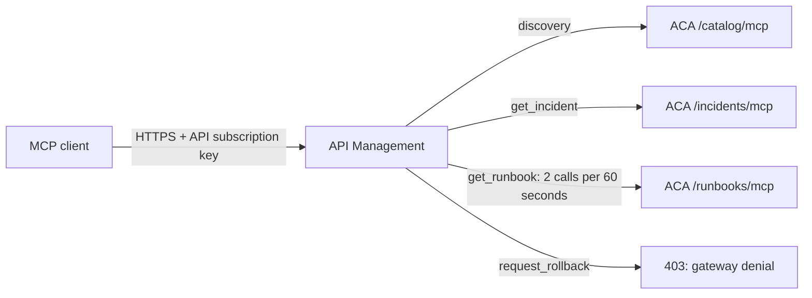

# MCP tool routing through API Management to Container Apps

**One real MCP server container, three SDK endpoint paths, one gateway URL.**
Explore how a gateway controls access to MCP tools using fictional WARNERCO incident
INC-1042 and its owner, Priya Patel. You can run the local checks without an Azure
account. The optional deployment uses existing Azure infrastructure.

## Request path



The three paths run inside one container. They are distinct MCP endpoint instances,
not three separately deployed microservices. `servedBy` in each successful tool
result identifies the endpoint that actually executed it. An outbound gateway header
independently records the policy's route selection.

| Request | Gateway decision | Backend evidence |
| --- | --- | --- |
| `tools/list` | Default discovery route | Three tools in the catalog |
| `get_incident(INC-1042)` | Incident route | Priya Patel; `servedBy: incidents` |
| `get_runbook(Order API)` | Runbook route | Approved steps; `servedBy: runbooks` |
| Repeated runbook calls | Runbook-specific throttle, configured at 2 per 60 seconds | Observed HTTP 429 and `Retry-After` |
| Incident lookup after that throttle | Independent incident route | Still succeeds |
| `request_rollback(INC-1042)` | Denied by the tool allowlist | HTTP 403 and explicit policy marker |
| Gateway call without a subscription key | Caller authentication failure | HTTP 401 |
| Direct ACA call without backend credential | Backend authentication failure | HTTP 401 |
| Incident call with a forged runbook routing header | Body still selects the incident route | `servedBy: incidents` |

The rate limit is an approximate distributed control. The verifier makes at most
12 calls, stops at the first observed 429, and then proves that incident lookup
still works. It doesn't promise that a particular numbered call will be rejected.
That qualification follows [Microsoft's rate-limit guidance](https://learn.microsoft.com/azure/api-management/rate-limit-by-key-policy).

Rollback is a non-mutating teaching fixture. Its server implementation also refuses
execution. Nothing in this demonstration can roll back an actual service.

## Run locally

From the repository root:

```powershell
# The course lock already contains the SDK, HTTP client, ASGI router, and server.
uv run --locked --project .\python python .\azure-demo\verify_demo.py --local
```

Each local run reserves its own loopback port and shuts down only the server it
started. You can repeat the command or run two copies together without clearing
a port or stopping another application.

## Deploy

Use `Deploy-Demo.ps1` with an existing subscription, tenant, resource group,
APIM instance, Consumption Container Apps environment, registry, and registry-pull
managed identity. Its parameter help names those inputs. It creates only the
`warnerco-class-mcp` Container App and the classroom API, backends, named value,
and API-scoped subscription in the selected APIM service.

The selected APIM tier must support native MCP APIs and `rate-limit-by-key`;
this deployment was verified on Basic v2. This is a Windows PowerShell 7 workflow
because the local credential cache uses Windows DPAPI. Sign in with Azure CLI
before deploying. The existing user-assigned identity must already have registry
pull access.

The remote build context includes only the reviewed server, Dockerfile, and course
dependency files. The generated backend credential is protected locally with Windows
DPAPI in the ignored `.local` folder. Azure stores it as an ACA secret and an APIM
secret named value. The client subscription key and backend credential are different.
All four container build inputs contribute to the image tag. `-SkipBuild` verifies
that the corresponding registry image exists before changing the Container App.
Ordinary reruns reuse the saved backend credential and the last successful image
when its content hash still matches and the image exists. Use `-Rebuild` only when
you intentionally want another build. Saved state is replaced atomically and
pinned to the recorded Azure environment; a conflicting environment is rejected.
Only one deployment from this checkout may run at a time.
The script waits for ACA provisioning instead of assuming the initial ARM response
already contains a hostname.

After deployment:

```powershell
# ARM supplies the API-scoped key to the child process without displaying it.
.\azure-demo\Test-Demo.ps1
```

Wait at least 60 seconds between full live runs so the previous throttle window
doesn't affect the next demonstration. Results are saved without credentials in
`azure-demo/.local/live-verification.json`.

The live test retrieves credentials through Azure Resource Manager. To run it
yourself, your signed-in account needs access to the selected deployment and its
API subscription key. Local verification does not need those credentials.

## Read the results

1. Compare the catalog with the gateway policy in [`policy.xml`](policy.xml).
   Discovering a tool does not mean you are authorized to execute it.
2. Compare incident and runbook results. `servedBy` identifies the endpoint that
   executed the tool; `X-Warnerco-Route` identifies the gateway's selected route.
3. Inspect the rollback refusal. The 403 shows that the gateway rejected the call.
4. Compare the throttled runbook request with the successful incident request.
   A limit on one tool need not block another.
5. Inspect the direct container request without its backend credential. Its 401
   demonstrates that bypassing the gateway does not bypass authentication.

The request body determines the tool name. An untrusted routing header can't select
a backend. The throttle key uses APIM's authenticated subscription identity.
Responses are forwarded without reading or buffering their bodies.

MCP gives the client a common way to discover and call these tools. The host still
decides which returned information to put into the model's context. The gateway
controls whether a request may run and where it goes; it does not decide which
incident facts are relevant to the model's next answer.

## Boundaries and cost

- This demonstrates API subscription-key authentication and an independent backend
  credential. It doesn't demonstrate OAuth consent, Entra scopes, per-user RBAC,
  or private networking.
- The ACA hostname is publicly reachable, but MCP requests require the backend
  credential. A private network design is a separate extension.
- The container uses 0.25 vCPU, 0.5 GiB, zero minimum replicas, and one maximum replica.
  East US retail active compute checked October 20, 2026 is about $0.027 per hour,
  before free allowances. Requests, logs, registry storage, and ACR builds are separate.
- Existing APIM, registry, and environment charges continue. Reusing them avoids a
  new gateway base charge; it doesn't make the overall environment free.
- Scale-to-zero can introduce cold-start latency. Allow for cold starts when comparing response times.
- Raw checks request the 2025-06-18 compatibility protocol. The official SDK client
  also negotiated 2026-07-28, discovered all three tools, and executed the incident
  tool through APIM. These protocol checks do not test a desktop host interface.
- Tool routing uses an API-level policy that examines `tools/call`, not individual
  APIM tool-policy subresources. The server remains responsible for its tool schemas.

## Sources

- [Native MCP resources and policies](https://learn.microsoft.com/azure/api-management/manage-mcp-servers-rest-api)
- [Conditional backend routing](https://learn.microsoft.com/azure/api-management/set-backend-service-policy)
- [Policy expressions and preserved request bodies](https://learn.microsoft.com/azure/api-management/api-management-policy-expressions)
- [Per-key rate limits](https://learn.microsoft.com/azure/api-management/rate-limit-by-key-policy)
- [Container Apps pricing](https://azure.microsoft.com/pricing/details/container-apps/)

## Verification record

Local verification passed October 20, 2026: discovery, both correct execution routes,
wrong-route rejection, and missing-backend-credential rejection. The catalog rejects
incident execution, rollback execution, and an unknown RPC method.
Live gateway verification also passed: authentication at both boundaries, discovery,
both execution routes, SDK protocol negotiation, rollback denial, throttle isolation,
and rejection of a forged routing hint. The dated report is under `evidence/`;
the most recent local run remains under `.local/`. The published report includes
the measured command timings and the final warm run's actual response bodies.
Those timings describe one deployment, not a performance guarantee.

### Corrections established by live testing

| Failure | Cause and correction | Preventive evidence |
| --- | --- | --- |
| Initial ACA response had no hostname | ARM creation is asynchronous; poll provisioning with a five-minute bound. | Final deployment reaches `Succeeded` before configuring APIM. |
| APIM rejected the published endpoint array | This instance's preview contract requires `mcpProperties.endpoints` as a dictionary. The native API is explicitly bound by `backendId`. | Deploy with the observed schema; read back the binding; test discovery through the gateway. |
| Discovery returned 500 | Trace metadata rejected an empty tool name on non-tool requests; emit `none`. | Both `tools/list` and SDK discovery succeed. |
| A rapid third runbook call still succeeded | Distributed counters don't guarantee an exact rejection ordinal. | Bound the burst, require an observed 429 and `Retry-After`, then require incident success. |

The first local verification attempt imported `httpx`, while the locked SDK uses
`httpx2`. The verifier now reuses that locked dependency. The local subprocess
check prevents that import mismatch from being recorded as a passing demo.
