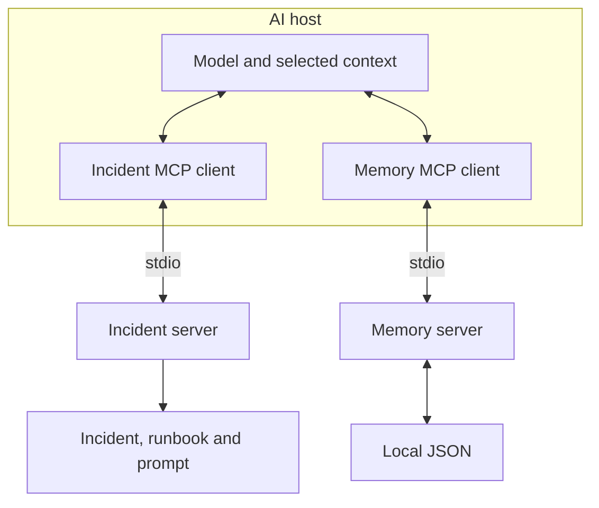

# Understand the connection; engineer the context

Keep three questions in view: what information does the assistant need, where
does it come from, and what is the assistant permitted to do?

The developer experience explains how to expose and verify capabilities.
The maker, builder and author experience explains how to select context and
govern its use.

## Foundations

| Term | Meaning in this course |
|---|---|
| Prompt engineering | Shape task instructions and the desired response. |
| Context engineering | Select and arrange instructions, evidence, history and tool information for a task. |
| Context window | The model's bounded working capacity, measured using its tokenizer. |
| Model | Generates responses and may propose tool calls. It does not itself launch the local server. |
| Host | Coordinates the model, user interaction, context and tool permissions. |
| MCP client | Communicates with a server. A script can be a client without a model. |
| MCP server | Exposes capabilities through the protocol; may wrap an API, file, database or service. |
| Tool | Callable operation with an input schema; a read-only lookup is still an operation. |
| Resource | URI-addressed reference data a client can read. |
| Prompt | Reusable request template. Retrieving it does not execute its instructions. |
| Persistent memory | Application data retained outside a conversation and retrieved later. MCP is not the storage system. |

See the [official MCP architecture](https://modelcontextprotocol.io/docs/2026-07-28/learn/architecture).
A connected data source is not automatically part of a model's input.

Both local servers run as child processes over stdin/stdout. The official SDK
handles JSON-RPC and discovery. Remote deployment uses a network transport such
as Streamable HTTP and needs explicit authentication and authorization. A
completed exchange can still contain an application-level tool error.

## Authoring with bounded context

Compare the [incident brief](../context/incident-brief.txt) and
[large fixture](../context/large-context.txt). Keep the task, known facts, important
constraints and source references. Retrieve detailed procedures when relevant.
File bytes and word counts are not measured model token usage or cost.

A concise instruction is: "Separate observed facts from hypotheses. Recommend one
next check. Request approval before changes." This guides behavior; the host and
service must enforce actual permissions.

Use this version-aware Claude Code sequence:

1. Run `claude --version` in PowerShell. Inside Claude Code, open `/help`.
2. Use `/context` to inspect usage. Compare displayed categories before and after
   referencing the incident brief. Treat these as host estimates.
3. Use `/branch incident-alternative` to switch into a conversational branch.
   It inherits the transcript; branching does not empty the context window.
4. Explain `/fork` separately. Current releases copy the conversation into a
   background session while the original remains active. With agent view disabled,
   a forked subagent is used. Check the installed menu before demonstrating it.
5. Start a fresh conversation for the memory retrieval proof. A branch already
   has earlier history and cannot prove independent retrieval.

These are Claude Code commands, not generic Copilot commands. The
[current command reference](https://code.claude.com/docs/en/commands) documents
the distinction. Behavior was reviewed October 21, 2026; installed UI and account
availability still require rehearsal.

| Technique | Appropriate use | Boundary |
|---|---|---|
| Project instructions | Stable conventions and constraints | Keep them short; they do not enforce access controls. |
| Subagent | Give a bounded subtask its own context and request a concise result | Some modes inherit history. Separate context does not mean separate file permissions. |
| Skill | Load a reusable workflow when relevant | Progressive disclosure reduces always-loaded text; it grants no service authorization. |
| Retrieval | Bring in task-specific evidence | Evaluate relevance, source and freshness. |
| Conversation compaction | Summarize a conversation to reclaim room | Summaries can omit details and are not authoritative durable stores. |
| Persistent memory | Retain a reviewed decision for a later conversation | Explicit retrieval and application selection remain necessary. |

In VS Code, inspect attached context and actual tool calls. Use a fresh chat to
reduce conversational carryover. Select the supported harness and configuration
destination; do not assume `/context` or `/fork` exists there.

Primary guides: [Claude subagents](https://code.claude.com/docs/en/sub-agents),
[Claude skills](https://code.claude.com/docs/en/skills),
[VS Code skills](https://code.visualstudio.com/docs/agent-customization/agent-skills)
and [VS Code MCP](https://code.visualstudio.com/docs/agent-customization/mcp-servers).

## From memory to a request

Write a decision, store it in JSON, retrieve ranked candidates, select useful
text, compact it within the budget, explicitly add it to a request, then reuse it.
The [memory tutorial](../TUTORIALS.md#4-carry-memory-across-processes) demonstrates
each boundary. Its automated script ends with request-file assembly. Attaching
that file to a fresh host chat completes the visible model-facing step.

Truncation is not semantic summarization. Character count is not token count.
Saving a decision does not automatically supply it to another conversation.

## Security and Azure

Inspect the [gateway design](../azure-demo/README.md). Its separate catalog,
incident and runbook endpoints route actual MCP requests, deny the rollback
fixture and throttle runbook calls independently of incident lookup.

| Boundary | What to explain or verify |
|---|---|
| Transport | Local stdio uses process permissions. Remote HTTP needs HTTPS and protected ingress. |
| Identity | Authenticate at gateway and backend. This demo uses separate keys, not per-user OAuth consent or Entra scopes. |
| Authorization | Enforce least privilege for tool and data access server-side. Host approval is a different control. |
| Tool output | Treat returned text as untrusted data; embedded instructions must not override the task or authorize changes. |
| Secrets | Keep credentials out of prompts, memory, tracked configurations and screenshots. |
| Rate limits | Observe denial and throttle results. Discovery does not authorize execution. |
| Operations | Redact sensitive logging; define retention, isolation, backup and revocation. |
| Verification | Test success, deliberate failure and policy boundaries independently. |

Local HTTP tests need no Azure access. Dated live evidence proves only the checks
on its recorded date. An architectural walkthrough needs no new deployment.

## Practice path

Run the Python incident client first. Inspect the tool, resource, prompt and
deliberate failure. Connect a supported host. Complete the MCP memory lifecycle
and inspect the generated context request. Finish with gateway controls and the
optional SQLite comparison. Ask which information changed the next decision and
which component enforced permission.
